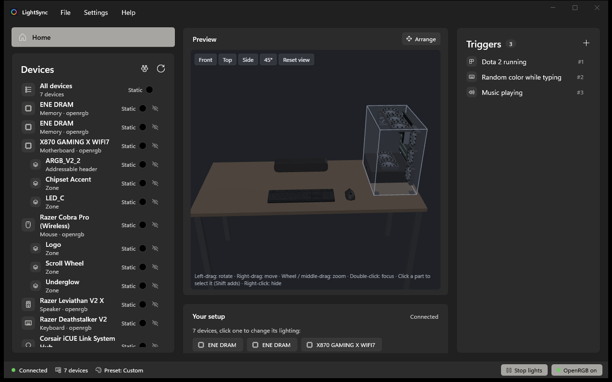
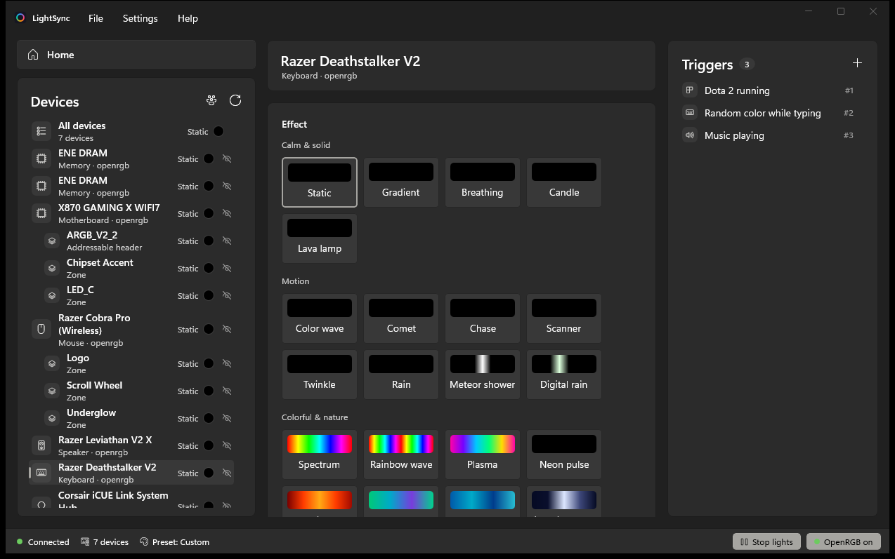
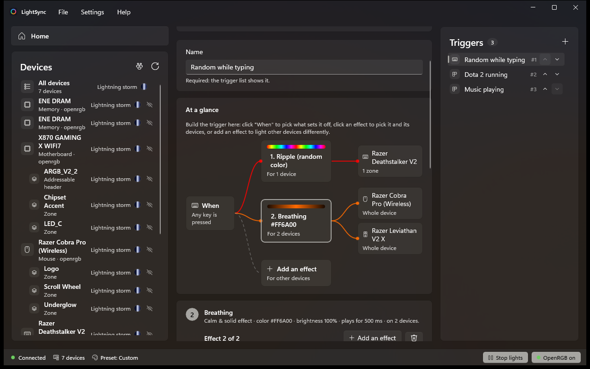

# LightSync

LightSync is a Windows app that controls all the RGB lighting in a PC from one place: motherboard
headers and fans, RAM, keyboard, mouse and speakers. It talks to the hardware through
[OpenRGB](https://openrgb.org).

**Why:** this is a personal project. I wanted one simple app for the lights on my own PC, instead
of a separate vendor app for each brand. It's shared as open source in case it's useful to someone
else; it has only been tested on that one PC.



## Features

| Feature | What it does |
|---|---|
| All devices in one list | Devices, zones and fans together; hide what you don't use; split fan headers into single fans; groups |
| 3D preview | A live 3D model of the case and desk in the current colors; drag parts to where they really are |
| 28 effects | Calm, motion, colorful and alert effects, and Beat, Bass and Spectrum for sound, each with color, brightness and speed |
| Music sync | Lights per device (the device acts as one LED) or per LED; follows what Windows is playing (spectrum, bass, treble, beat, tempo, mood), even at a low volume; kicks, claps and hi-hats hit even in loud electronic music |
| What's playing | A live spectrum of what it hears, and which app is playing it: the song, and for a browser the site (YouTube, YouTube Music, Spotify...) |
| Sound colors | One color, random (a set number of colors or a random number on every beat), cold to hot, low to high, rainbow, fire or neon |
| Triggers | A key press, a mouse click or movement, or one or more apps running or web sites open in a browser (like youtube.com, any of them) can play any mix of effects: a flash, pulse, ripple or glow, any of the 28 effects, or a preset, each on its own devices (whole devices or single keys and LEDs) or on all the others; priorities set from the list |
| Trigger builder | Each trigger is built on a map: what sets it off, its effects and the devices each one lights; click a box to change it. A device can have its own sound settings ("lights per", colors), else it uses the effect's |
| Presets | Save and load your lighting setups |
| Power | Lights off on sleep, lock or when idle; start with Windows; lives in the tray |
| OpenRGB management | Starts, stops and updates OpenRGB for you, listening on this PC only; Windows asks for administrator rights once (when installing), not on every start |

| Device | Triggers |
|---|---|
|  |  |

## Requirements

To **run**:
- Windows 10 (version 1809 or later) or Windows 11, 64-bit
- [OpenRGB](https://openrgb.org) 1.0 or later (LightSync can install it). OpenRGB needs administrator
  rights for motherboard and RAM lighting, so Windows asks once.
- [Microsoft Edge WebView2 Runtime](https://developer.microsoft.com/microsoft-edge/webview2/) for the
  3D preview (already part of Windows 11)

To **build**:
- [Rust](https://rustup.rs) (stable, MSVC)
- [.NET 10 SDK](https://dotnet.microsoft.com/download/dotnet/10.0)
- Visual Studio Build Tools with "Desktop development with C++"

```powershell
cargo build -p lightsyncd                    # the lighting service
dotnet run --project ui\LightSync.App        # the app (starts the service)
cargo test --workspace                       # tests
```

To make the installer, `dist\LightSync-Setup-<version>.exe` (installs for the current user, with Start
menu and desktop shortcuts, and uninstalls from Settings > Apps; the app is self-contained, so no .NET
is needed to run it):

```powershell
powershell -ExecutionPolicy Bypass -File installer\build-release.ps1
```

## How it's built

A WinUI 3 app (`ui/LightSync.App`, C#) talks over a local named pipe to a small Rust service
(`crates/lightsyncd`), which renders the lighting at 30-60 frames a second and sends it to OpenRGB
(`crates/lightsync-openrgb`) on 127.0.0.1.

## Privacy

Everything stays on the PC. Sound and key presses are only processed in memory, never stored or
sent. To show what is playing, the app reads which apps make sound, the media Windows knows about and,
for a browser, the name of the tab that plays, only while a sound view is open and never stored or
sent. A trigger that watches a web site reads the host of the page each window of that browser shows
(nothing else of the address), and only tells the service whether the watched site is open. The only
online request is the check for new OpenRGB versions.

## Contributing

Issues and small pull requests are welcome: see [CONTRIBUTING.md](CONTRIBUTING.md), including the
privacy rules every change keeps, and the [code of conduct](CODE_OF_CONDUCT.md).

## License

[MIT](LICENSE) © 2026 Rogerio Tristao Junior. See [THIRD_PARTY_NOTICES.md](THIRD_PARTY_NOTICES.md)
for the software it uses. OpenRGB is a separate program and isn't included.
